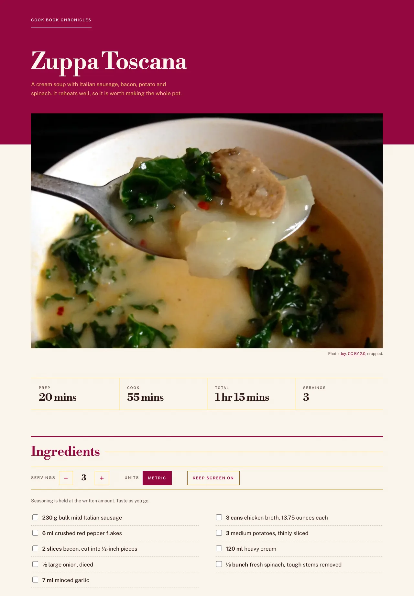

# Cook Book Chronicles

Read this in Polish: [README.pl.md](README.pl.md)

A recipe website with two recipes: zuppa toscana and futomaki sushi. Static HTML, CSS and a little JavaScript.
No build step and no dependencies.

Live site: <https://netbr3ak.github.io/Cook-book-Chronicles/>

## Contents

- [What it does](#what-it-does)
- [How it is built](#how-it-is-built)
- [How to run it](#how-to-run-it)
- [Tests](#tests)
- [Credits](#credits)
- [License](#license)

## What it does

- The home page lists the recipes.
- Each recipe has its own page with ingredients and steps.
- Scale the servings, and switch between US and metric units.
- Tick off ingredients and steps as you cook.
- Start a timer on any step that states a time.
- Keep the screen awake while you cook, where the browser supports it.
- Point at an ingredient, or move focus to it, to see where it is used in the directions.

Every page reads in full with JavaScript turned off. The scripts add the controls on top.

## How it is built

| File | What it holds |
|---|---|
| `index.html` | The list of recipes. |
| `recipes_list/*.html` | One page per recipe. Each ingredient keeps its amount and unit in `data-qty` and `data-unit`, so the script can rescale it. |
| `quantities.js` | The quantity maths: scaling, fractions, metric units. It does not touch the page, so the tests run it in Node. |
| `recipe.js` | The controls on a recipe page: servings, units, screen lock, step timers, ingredient highlight. |
| `styles.css` | One stylesheet for every page, the print layout included. |

## How to run it

1. Clone the repository:
   `git clone https://github.com/NetBr3ak/Cook-book-Chronicles.git`
2. Serve the folder with any static file server, for example:
   `cd Cook-book-Chronicles && python3 -m http.server 8000`
3. Open <http://localhost:8000/> in a web browser.

## Tests

The quantity maths has its own tests in `test/`. Run them with `node --test` from the repository root.
GitHub Actions runs the same command on Node.js 26 for every push and pull request.

## Credits

- Zuppa Toscana is adapted from "Super-Delicious Zuppa Toscana" on Allrecipes. The ingredients follow it; the
  steps are written fresh. The futomaki recipe follows no single published source.
- Photographs, both under [CC BY 2.0](https://creativecommons.org/licenses/by/2.0/). The site resizes them and
  crops the zuppa toscana photo and both share images (`images/og-*.jpg`):
  - Zuppa toscana: [Zuppa Tosacana](https://commons.wikimedia.org/wiki/File:Zuppa_Tosacana.jpg) by Joy.
  - Futomaki: [Futomaki (half order)](https://commons.wikimedia.org/wiki/File:Futomaki_(half_order)_(4408590378).jpg)
    by Geoff Peters.
- Fonts: Libre Bodoni and Public Sans, both self-hosted in `fonts/` as latin subsets. They are used under
  the SIL Open Font License, Version 1.1. The licence and the copyright lines are in `fonts/OFL.txt`.

## License

The code and the text are under the [MIT license](LICENSE). The photographs keep their CC BY 2.0 licence and the
fonts keep the SIL Open Font License 1.1, as listed in [Credits](#credits).
