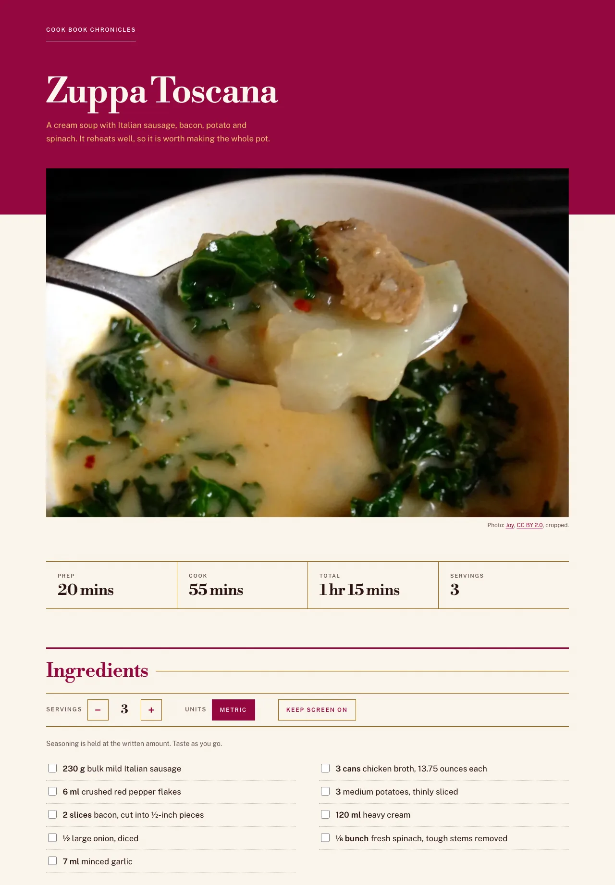

# Cook Book Chronicles

Read this in English: [README.md](README.md)

Strona z dwoma przepisami: zuppa toscana i futomaki. Statyczny HTML, CSS i trochę JavaScriptu.
Bez kroku budowania (build) i bez zależności.

Strona na żywo: <https://netbr3ak.github.io/Cook-book-Chronicles/>

## Spis treści

- [Co robi](#co-robi)
- [Jak jest zbudowana](#jak-jest-zbudowana)
- [Jak uruchomić](#jak-uruchomić)
- [Testy](#testy)
- [Źródła](#źródła)
- [Licencja](#licencja)

## Co robi

- Strona główna pokazuje listę przepisów.
- Każdy przepis ma swoją stronę ze składnikami i krokami.
- Możesz przeliczyć porcje i przełączyć jednostki amerykańskie na metryczne.
- Możesz odhaczać składniki i kroki w trakcie gotowania.
- Przy każdym kroku z podanym czasem możesz włączyć minutnik.
- Możesz nie pozwolić ekranowi zgasnąć, jeśli przeglądarka to obsługuje.
- Wskaż składnik kursorem albo ustaw na nim fokus, żeby zobaczyć, gdzie występuje w krokach.

Każdą stronę da się przeczytać w całości z wyłączonym JavaScriptem. Skrypty dokładają do tego przyciski, minutniki i podświetlanie.

## Jak jest zbudowana

| Plik | Co zawiera |
|---|---|
| `index.html` | Listę przepisów. |
| `recipes_list/*.html` | Po jednej stronie na przepis. Każdy składnik ma ilość i jednostkę w `data-qty` i `data-unit`, więc skrypt może je przeliczyć. |
| `quantities.js` | Przeliczanie ilości: porcje, ułamki, jednostki metryczne. Nie dotyka strony, więc testy uruchamiają go w Node. |
| `recipe.js` | Przyciski na stronie przepisu: porcje, jednostki, blokada wygaszania ekranu, minutniki, podświetlanie składników. |
| `styles.css` | Jeden arkusz stylów dla wszystkich stron, razem z układem do druku. |

## Jak uruchomić

1. Sklonuj repozytorium:
   `git clone https://github.com/NetBr3ak/Cook-book-Chronicles.git`
2. Udostępnij folder dowolnym serwerem plików statycznych, na przykład:
   `cd Cook-book-Chronicles && python3 -m http.server 8000`
3. Otwórz <http://localhost:8000/> w przeglądarce.

## Testy

Przeliczanie ilości ma własne testy w `test/`. Uruchom je komendą `node --test` w głównym folderze repozytorium.
GitHub Actions uruchamia tę samą komendę na Node.js 26 przy każdym pushu i pull requeście.

## Źródła

- Zuppa Toscana powstała na podstawie przepisu „Super-Delicious Zuppa Toscana” z Allrecipes. Składniki są te same,
  kroki napisano od nowa. Przepis na futomaki nie ma jednego źródła.
- Zdjęcia, oba na licencji [CC BY 2.0](https://creativecommons.org/licenses/by/2.0/). Strona je pomniejsza,
  a zdjęcie zuppa toscana i oba obrazki do udostępniania (`images/og-*.jpg`) przycina:
  - Zuppa toscana: [Zuppa Tosacana](https://commons.wikimedia.org/wiki/File:Zuppa_Tosacana.jpg), fot. Joy.
  - Futomaki: [Futomaki (half order)](https://commons.wikimedia.org/wiki/File:Futomaki_(half_order)_(4408590378).jpg),
    fot. Geoff Peters.
- Fonty: Libre Bodoni i Public Sans, hostowane lokalnie w `fonts/` jako podzbiory znaków łacińskich.
  Używamy ich na licencji SIL Open Font License, wersja 1.1. Licencja i noty copyright są w `fonts/OFL.txt`.

## Licencja

Kod i tekst są na licencji [MIT](LICENSE). Zdjęcia mają własną licencję CC BY 2.0, a fonty SIL Open Font
License 1.1, jak podaje sekcja [Źródła](#źródła).
